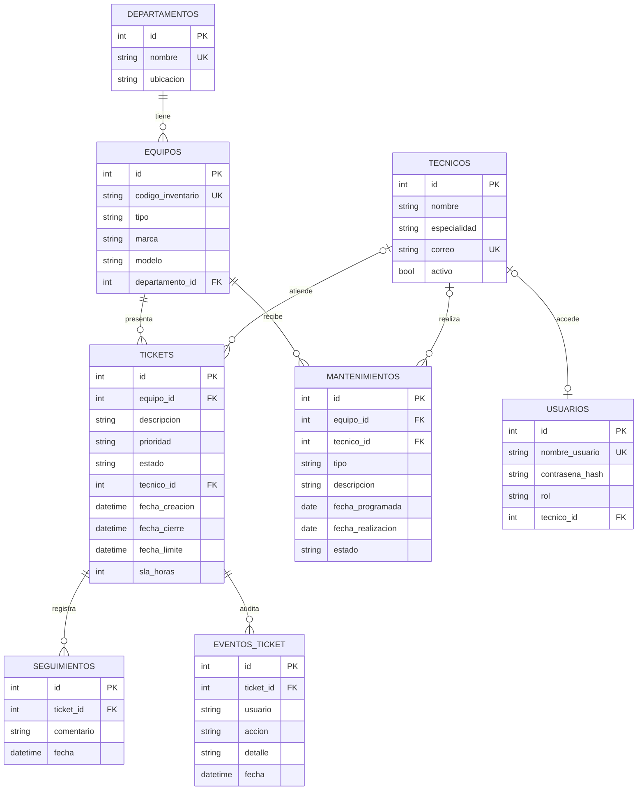

# Diagrama entidad-relación — Mesa de ayuda

Pega este bloque en GitHub o en un editor compatible con Mermaid para visualizarlo.

## Relaciones

- Un departamento puede tener muchos equipos; cada equipo pertenece a un departamento.
- Un equipo puede tener muchos tickets; cada ticket se refiere a un equipo.
- Un técnico puede atender muchos tickets; un ticket puede permanecer sin técnico antes de asignarse.
- Un ticket puede tener muchos seguimientos; para cerrarlo se exige al menos uno.
- Un ticket mantiene eventos de auditoría para registrar su actividad y cambios.
- Un equipo puede tener muchos mantenimientos; cada mantenimiento puede asignarse a un técnico.
- Un usuario puede estar asociado a un técnico (opcional para administrador).
